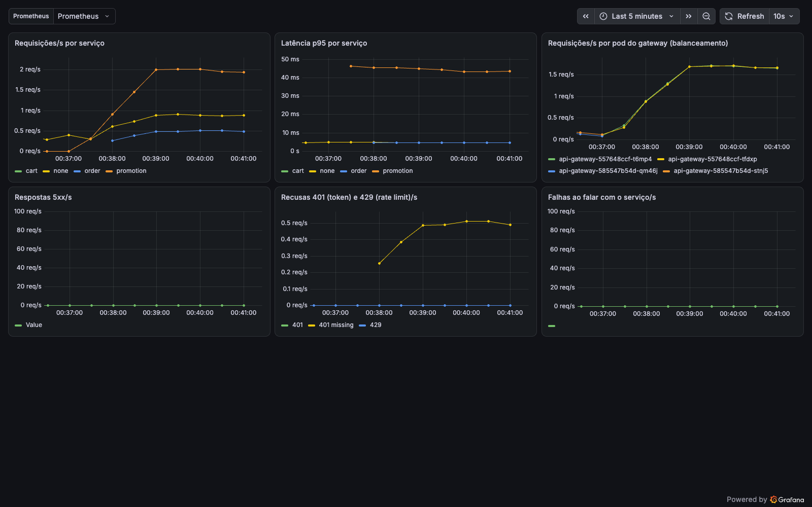
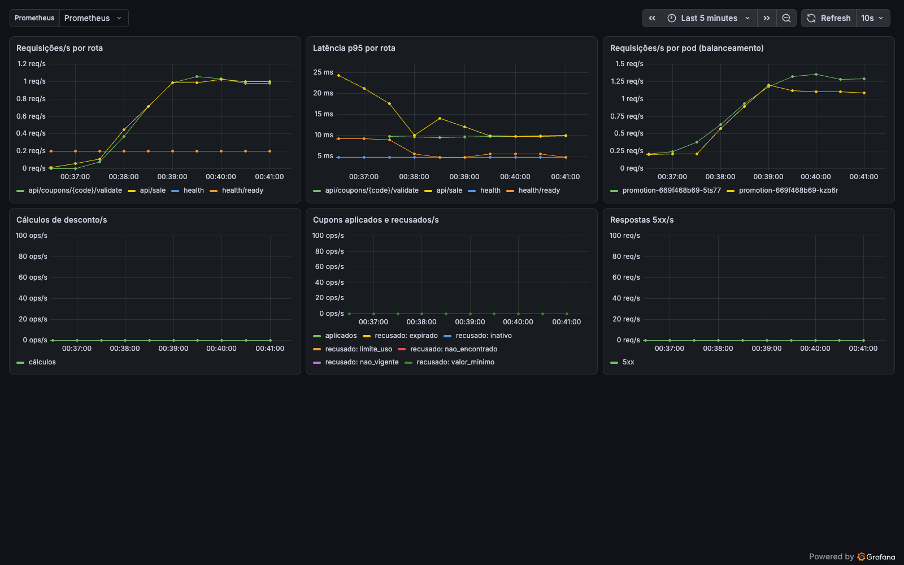

# Evidência: GANJJ no Amazon EKS (27/10/2026)

Cluster `ganjj` criado no AWS Academy Learner Lab (conta education do Lucas, `us-east-1`) com o kit
[`api-gateway/eks`](https://github.com/Back-End-Cloud-Computing/api-gateway/tree/main/eks): `eksctl` com as roles
`LabEks*` do lab, 2 nodes `t3.large` (Amazon Linux 2023, Kubernetes 1.34), NGINX Ingress Controller
`controller-v1.15.1` (manifest AWS, ELB) e os `k8s/` dos 11 repos aplicados por `eks/apply.sh`. Coleta entre
23:44 e 00:03 (BRT); os horários da saída estão em UTC.

| Critério da rubrica | Resultado | Onde ver |
|---|---|---|
| R2 Amazon EKS, Docker, Deployments, Pods, Services | 23 pods `1/1 Running` dos 11 serviços e bancos; um Service por serviço | [Cluster](#cluster) |
| R2 Ingress NGINX | `GET /api/sale` 200 pelo hostname do ELB; `/internal/health` e `/metrics` 404 | [Ingress pelo ELB](#ingress-pelo-elb) |
| R2 Balanceamento entre réplicas | 10 requisições: 2 pods do gateway (`x-gateway-served-by`) e 2 do promotion (`x-served-by`) se alternam | [Balanceamento](#balanceamento-10-requisições) |
| R2 Service Discovery | URLs dos ConfigMaps só com nome de Service (`http://promotion:8000`, `rabbitmq:5672`) | [Service Discovery](#service-discovery) |
| R3 RabbitMQ: publicação, consumo e processamento | `OrderConfirmed` publicado em `ganjj.orders`; consumer registra `consumed` e `usage_count` de `BEMVINDO10` vai de 0 para 1; a mesma mensagem republicada vira `duplicate` e o contador fica em 1 | [RabbitMQ](#rabbitmq-publicação-consumo-e-processamento) |

Limites desta execução, ditos como são:

- A mensagem foi publicada por AMQP de dentro do pod do `promotion-consumer` (php-amqplib), porque o publisher do
  Order ainda não existe ([order#20](https://github.com/Back-End-Cloud-Computing/order/issues/20)). Consumo e
  processamento estão demonstrados; a publicação pelo Order, não.
- Sem painel do RabbitMQ: a imagem `rabbitmq:4.1-alpine` do support não traz o plugin de management e o Service só
  expõe a 5672. As filas e os bindings saem do `rabbitmqctl`.
- O Support continua ligado em `order.created`, não em `order.confirmed`
  ([support#11](https://github.com/Back-End-Cloud-Computing/support/issues/11)).
- Bancos em `emptyDir` (o node role do Learner Lab não tem a policy do EBS CSI): os dados somem quando o pod é
  recriado. O promotion foi semeado com `php artisan db:seed --force` antes da coleta.
- Credenciais geradas no cluster pelo `apply.sh`; nenhum valor aparece aqui.

## Extra: Prometheus e Grafana (28/10/2026)

Fora da rubrica (`origem: nossa`). No mesmo cluster, `api-gateway/k8s/observability/install.sh` instalou o
`kube-prometheus-stack` 92.3.0; o Prometheus raspou os 13 pods anotados e o Grafana carregou os dashboards dos
repos. Prints tirados com ~5 min de tráfego pelo ELB (`/api/sale`, validação de cupom e rotas protegidas sem
token), já com o gateway na imagem 1.1.1:

- Solução, pelo gateway: requisições por serviço, p95, as 2 réplicas do gateway dividindo a carga e as recusas
  401 das rotas protegidas.

  

- Promotion: requisições e p95 por rota e as 2 réplicas do promotion dividindo a carga. Cupons aplicados ficam em
  zero porque a validação pública não aplica cupom; isso só acontece no cálculo interno e no consumer.

  

## Saída

### Cluster

```console
$ kubectl config current-context
<usuario-do-lab>@ganjj.us-east-1.eksctl.io
```

```console
$ kubectl get nodes -o wide
NAME                            STATUS   ROLES    AGE   VERSION                INTERNAL-IP     EXTERNAL-IP       OS-IMAGE                        KERNEL-VERSION                     CONTAINER-RUNTIME
ip-192-168-20-71.ec2.internal   Ready    <none>   20m   v1.34.12-eks-39aca56   192.168.20.71   3.236.223.168     Amazon Linux 2023.12.20261021   6.12.111-136.204.amzn2023.x86_64   containerd://2.3.5+unknown
ip-192-168-40-38.ec2.internal   Ready    <none>   20m   v1.34.12-eks-39aca56   192.168.40.38   184.195.124.143   Amazon Linux 2023.12.20261021   6.12.111-136.204.amzn2023.x86_64   containerd://2.3.5+unknown
```

```console
$ kubectl get pods -A -o wide
NAMESPACE       NAME                                        READY   STATUS    RESTARTS      AGE     IP               NODE                            NOMINATED NODE   READINESS GATES
default         api-gateway-585547b54d-qm46j                1/1     Running   0             7m2s    192.168.0.179    ip-192-168-20-71.ec2.internal   <none>           <none>
default         api-gateway-585547b54d-stnj5                1/1     Running   0             7m19s   192.168.50.60    ip-192-168-40-38.ec2.internal   <none>           <none>
default         authorization-5df5878c4-g9d2q               1/1     Running   0             18m     192.168.34.141   ip-192-168-40-38.ec2.internal   <none>           <none>
default         chromadb-57659fd7fc-xnbwt                   1/1     Running   0             18m     192.168.10.172   ip-192-168-20-71.ec2.internal   <none>           <none>
default         client-59cd7f546d-4rs28                     1/1     Running   4 (17m ago)   18m     192.168.25.187   ip-192-168-20-71.ec2.internal   <none>           <none>
default         embedding-reranking-7ccf67474d-lznj5        1/1     Running   0             18m     192.168.37.243   ip-192-168-40-38.ec2.internal   <none>           <none>
default         llm-provider-7d57cd9f6d-w5clv               1/1     Running   2 (15m ago)   18m     192.168.17.139   ip-192-168-20-71.ec2.internal   <none>           <none>
default         mailpit-6dcf6c7846-mqrqx                    1/1     Running   0             17m     192.168.50.227   ip-192-168-40-38.ec2.internal   <none>           <none>
default         mongodb-6cc7df5587-5kvsp                    1/1     Running   0             18m     192.168.13.128   ip-192-168-20-71.ec2.internal   <none>           <none>
default         oracle-auth-585fdcfd97-klfb2                1/1     Running   0             18m     192.168.46.227   ip-192-168-40-38.ec2.internal   <none>           <none>
default         order-5684d6fd48-9nt8g                      1/1     Running   1 (16m ago)   17m     192.168.57.232   ip-192-168-40-38.ec2.internal   <none>           <none>
default         order-sqlserver-0                           1/1     Running   0             16m     192.168.19.131   ip-192-168-20-71.ec2.internal   <none>           <none>
default         postgres-client-8978cf789-25sgb             1/1     Running   0             18m     192.168.3.50     ip-192-168-20-71.ec2.internal   <none>           <none>
default         product-api-6db8f9c55c-f6brq                1/1     Running   2 (15m ago)   18m     192.168.56.62    ip-192-168-40-38.ec2.internal   <none>           <none>
default         promotion-669f468b69-5ts77                  1/1     Running   0             17m     192.168.27.96    ip-192-168-20-71.ec2.internal   <none>           <none>
default         promotion-669f468b69-kzb6r                  1/1     Running   0             17m     192.168.51.106   ip-192-168-40-38.ec2.internal   <none>           <none>
default         promotion-consumer-869845495f-5krhz         1/1     Running   2 (17m ago)   17m     192.168.40.186   ip-192-168-40-38.ec2.internal   <none>           <none>
default         promotion-db-69c8f9ff4b-vw2qx               1/1     Running   0             17m     192.168.36.223   ip-192-168-40-38.ec2.internal   <none>           <none>
default         rabbitmq-5f694fb8c8-5q5ws                   1/1     Running   0             17m     192.168.8.245    ip-192-168-20-71.ec2.internal   <none>           <none>
default         redis-7d5c89bcc9-4f42d                      1/1     Running   0             18m     192.168.15.251   ip-192-168-20-71.ec2.internal   <none>           <none>
default         shopping-cart-96f57db69-fmg57               1/1     Running   0             18m     192.168.12.140   ip-192-168-20-71.ec2.internal   <none>           <none>
default         support-75658d77c4-zjld8                    1/1     Running   0             17m     192.168.12.63    ip-192-168-20-71.ec2.internal   <none>           <none>
default         vector-db-6bb5945fc4-mhzjs                  1/1     Running   1 (16m ago)   18m     192.168.28.146   ip-192-168-20-71.ec2.internal   <none>           <none>
ingress-nginx   ingress-nginx-controller-86c5998465-ltw5v   1/1     Running   0             18m     192.168.35.237   ip-192-168-40-38.ec2.internal   <none>           <none>
kube-system     aws-node-8z9qw                              2/2     Running   0             20m     192.168.20.71    ip-192-168-20-71.ec2.internal   <none>           <none>
kube-system     aws-node-nn7bs                              2/2     Running   0             20m     192.168.40.38    ip-192-168-40-38.ec2.internal   <none>           <none>
kube-system     coredns-545d4db4b5-r4cvf                    1/1     Running   0             23m     192.168.25.66    ip-192-168-20-71.ec2.internal   <none>           <none>
kube-system     coredns-545d4db4b5-xp55t                    1/1     Running   0             23m     192.168.5.249    ip-192-168-20-71.ec2.internal   <none>           <none>
kube-system     kube-proxy-lfbd5                            1/1     Running   0             20m     192.168.40.38    ip-192-168-40-38.ec2.internal   <none>           <none>
kube-system     kube-proxy-zq7rq                            1/1     Running   0             20m     192.168.20.71    ip-192-168-20-71.ec2.internal   <none>           <none>
kube-system     metrics-server-68c65f79d8-bhbh9             1/1     Running   0             18m     192.168.56.203   ip-192-168-40-38.ec2.internal   <none>           <none>
kube-system     metrics-server-68c65f79d8-wflss             1/1     Running   0             18m     192.168.22.254   ip-192-168-20-71.ec2.internal   <none>           <none>
```

```console
$ kubectl get svc
NAME                  TYPE        CLUSTER-IP       EXTERNAL-IP   PORT(S)             AGE
api-gateway           ClusterIP   10.100.197.27    <none>        3000/TCP,9100/TCP   17m
authorization         ClusterIP   10.100.103.131   <none>        8081/TCP            18m
chromadb              ClusterIP   10.100.215.76    <none>        8000/TCP            17m
client                ClusterIP   10.100.232.151   <none>        8082/TCP            18m
embedding-reranking   ClusterIP   10.100.153.70    <none>        8003/TCP            18m
kubernetes            ClusterIP   10.100.0.1       <none>        443/TCP             26m
llm-provider          ClusterIP   10.100.18.10     <none>        8004/TCP            18m
mailpit               ClusterIP   10.100.92.86     <none>        1025/TCP,8025/TCP   16m
mongodb               ClusterIP   10.100.114.78    <none>        27017/TCP           17m
oracle-auth           ClusterIP   10.100.100.109   <none>        1521/TCP            17m
order                 ClusterIP   10.100.214.77    <none>        8080/TCP            17m
order-sqlserver       ClusterIP   None             <none>        1433/TCP            17m
postgres-client       ClusterIP   10.100.105.250   <none>        5432/TCP            17m
product-api           ClusterIP   10.100.41.209    <none>        8000/TCP            18m
promotion             ClusterIP   10.100.255.185   <none>        8000/TCP            17m
promotion-db          ClusterIP   10.100.145.25    <none>        3306/TCP            17m
rabbitmq              ClusterIP   10.100.132.98    <none>        5672/TCP            16m
redis                 ClusterIP   10.100.101.213   <none>        6379/TCP            17m
shopping-cart         ClusterIP   10.100.28.232    <none>        3003/TCP            18m
support               ClusterIP   10.100.141.165   <none>        8090/TCP            17m
vector-db             ClusterIP   10.100.194.245   <none>        8002/TCP            18m
```

```console
$ kubectl get ingress
NAME                  CLASS   HOSTS   ADDRESS                                                                         PORTS   AGE
api-gateway-ingress   nginx   *       a0a91c291e67a4e3bae35022ed5bad56-e8fc7489a7eccb99.elb.us-east-1.amazonaws.com   80      16m
```

```console
$ kubectl -n ingress-nginx get svc ingress-nginx-controller
NAME                       TYPE           CLUSTER-IP      EXTERNAL-IP                                                                     PORT(S)                      AGE
ingress-nginx-controller   LoadBalancer   10.100.112.40   a0a91c291e67a4e3bae35022ed5bad56-e8fc7489a7eccb99.elb.us-east-1.amazonaws.com   80:32046/TCP,443:30748/TCP   18m
```

### Ingress pelo ELB

```console
$ curl -s -i --max-time 10 http://$ELB/api/sale | head -20
HTTP/1.1 200 OK
Date: Wed, 28 Oct 2026 03:02:44 GMT
Content-Type: application/json
Transfer-Encoding: chunked
Connection: keep-alive
x-correlation-id: 8d840eb9-b4a7-4a8d-ab99-b9f1ed3a2e39
x-gateway-served-by: api-gateway-585547b54d-stnj5
x-ratelimit-limit: 100
x-ratelimit-remaining: 99
x-ratelimit-reset: 60
host: promotion:8000
x-powered-by: PHP/8.2.35
cache-control: no-cache, private
x-served-by: promotion-669f468b69-5ts77
access-control-allow-origin: *

[{"produto_id":"2","desconto_pct":40,"categoria":"Inverno","ativo":true},{"produto_id":"1","desconto_pct":30,"categoria":"Inverno","ativo":true},{"produto_id":"4","desconto_pct":20,"categoria":"Inferiores","ativo":true},{"produto_id":"3","desconto_pct":15,"categoria":"Superiores","ativo":true}]
```

```console
$ curl -s -o /dev/null -w '%{http_code}\n' --max-time 10 http://$ELB/api/coupons/BEMVINDO10/validate
200
```

```console
$ curl -s -o /dev/null -w '%{http_code}\n' --max-time 10 http://$ELB/internal/health
404
```

```console
$ curl -s -o /dev/null -w '%{http_code}\n' --max-time 10 http://$ELB/metrics
404
```

```console
$ curl -s -o /dev/null -w '%{http_code}\n' --max-time 10 http://$ELB/health
200
```

### Balanceamento (10 requisições)

```console
$ for i in $(seq 10); do curl -s -o /dev/null -D - --max-time 10 http://$ELB/api/sale | grep -iE 'served-by' | tr -d '\r' | sort | paste -sd' ' -; done
x-gateway-served-by: api-gateway-585547b54d-stnj5 x-served-by: promotion-669f468b69-5ts77
x-gateway-served-by: api-gateway-585547b54d-stnj5 x-served-by: promotion-669f468b69-kzb6r
x-gateway-served-by: api-gateway-585547b54d-qm46j x-served-by: promotion-669f468b69-5ts77
x-gateway-served-by: api-gateway-585547b54d-stnj5 x-served-by: promotion-669f468b69-kzb6r
x-gateway-served-by: api-gateway-585547b54d-qm46j x-served-by: promotion-669f468b69-kzb6r
x-gateway-served-by: api-gateway-585547b54d-qm46j x-served-by: promotion-669f468b69-kzb6r
x-gateway-served-by: api-gateway-585547b54d-stnj5 x-served-by: promotion-669f468b69-kzb6r
x-gateway-served-by: api-gateway-585547b54d-qm46j x-served-by: promotion-669f468b69-kzb6r
x-gateway-served-by: api-gateway-585547b54d-stnj5 x-served-by: promotion-669f468b69-5ts77
x-gateway-served-by: api-gateway-585547b54d-qm46j x-served-by: promotion-669f468b69-kzb6r
```

### Service Discovery

```console
$ kubectl get configmap -o yaml | grep -E '^    [A-Z_]+: (http://)?[a-z-]+:[0-9]+$' | sort -u
    APP_URL: http://promotion:8000
    AUTH_BASE_URL: http://authorization:8081
    CART_URL: http://shopping-cart:3003
    CLIENT_URL: http://client:8082
    ORDER_URL: http://order:8080
    PRODUCT_URL: http://product-api:8000
    PROMOTION_URL: http://promotion:8000
```

### RabbitMQ: publicação, consumo e processamento

Payload publicado por AMQP em `ganjj.orders` com routing key `order.confirmed` (mesmo caminho que o publisher do Order vai usar):

```json
{"schema_version":1,"event_type":"OrderConfirmed","order_id":"4ffe4167-0335-44a6-bffe-e88ae030eeab","coupon_code":"BEMVINDO10","items":[{"product_id":"1","quantity":2}]}
```

usage_count de BEMVINDO10 antes: **0**

Primeira publicação: `published`

usage_count depois da primeira: **1**

Republicação da mesma mensagem: `published`

usage_count depois da republicação: **1**

```console
$ kubectl logs deploy/promotion-consumer --since=2m | grep -E 'OrderConfirmed|4ffe4167-0335-44a6-bffe-e88ae030eeab'
[2026-10-28 03:02:53] production.INFO: OrderConfirmed processado {"order_id":"4ffe4167-0335-44a6-bffe-e88ae030eeab","outcome":"consumed"} 
[2026-10-28 03:03:02] production.INFO: OrderConfirmed processado {"order_id":"4ffe4167-0335-44a6-bffe-e88ae030eeab","outcome":"duplicate"} 
```

```console
$ kubectl exec deploy/rabbitmq -- rabbitmqctl list_queues name messages consumers
Listing queues for vhost / ...
name	messages	consumers
promotion.order-confirmed	0	1
support.order-created.dlq	0	0
promotion.order-confirmed.dlq	0	0
support.order-created	0	1
```

```console
$ kubectl exec deploy/rabbitmq -- rabbitmqctl list_bindings source_name routing_key destination_name
Listing bindings for vhost /...
source_name	routing_key	destination_name
	promotion.order-confirmed	promotion.order-confirmed
	support.order-created.dlq	support.order-created.dlq
	promotion.order-confirmed.dlq	promotion.order-confirmed.dlq
	support.order-created	support.order-created
ganjj.orders	order.confirmed	promotion.order-confirmed
ganjj.orders	order.created	support.order-created
```

